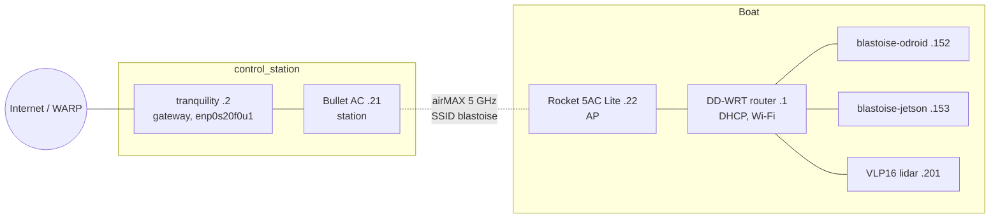

# mhseals_profile

MHSeals' profiles for [astro_dock](https://github.com/1unarzDev/astro_dock): every fact about our fleet,
boats, network and hosts lives here, so astro_dock stays team-agnostic.

```bash
astro profile sync https://github.com/MHSeals/mhseals_profile.git COMMIT   # once per machine
astro whoami                 # this machine's host, vessel and station, and how they were found
astro env LIDAR_IP           # one value of the vessel's network env
astro secrets check          # the missing secret names (never values)
```

| Directory | Holds |
| --- | --- |
| `roboboat/` | The fleet: `profile.yaml` (incl. the `astro:` section), `topology.yaml` (members and links), `secrets.keys`, `hosts.yaml` (repositories by role), and the shared `router`, `radio`, `lidar`, `jetson` YAMLs |
| `blastoise/` | Vessel (extends roboboat): `network.env` (subnet, router, gateway, DHCP, reservations, DNS, devices), `devices.yaml` (hosts, users and roles), its radios, and `profile.yaml` (lidar model, MAC and rpm, `hull:` outline, `thrusters:` wiring) |
| `squirtle/` | Vessel stub until its values are known (the Xavier NX, JetPack 5 / Foxy) |
| `sim/` | Vessel (extends blastoise): this machine only (`127.0.0.1`), ROS domain 101, its own state file (`~/.config/mhseals/hardware_sim.yaml`) and data dir (`bags/sim`), so a sim run never touches the boat's values |
| `control_station/` | Station (extends roboboat): the role of every operator laptop (RTK base, gateway, time); no laptop needs its own profile |

## Use from astro_dock

`astro profile sync URL COMMIT` records the repository and ref in `~/.config/astro/profiles.env` and checks
it out at astro_dock's `profiles/` (gitignored). Copy `profiles.env` to another machine and its first
command checks the profiles out; `astro profile sync` alone moves to the recorded ref and refuses local
changes (they belong here). To use a separate checkout as is, set `ASTRO_PROFILES=/path/to/mhseals_profile`.

**Which machine is which.** Boat computers find themselves by their `STATIC_LEASES` MAC, tranquility by
hostname. A registry host with the `operator` role is a control station, so tranquility resolves to host
tranquility, vessel blastoise, station `control_station`. Any other laptop joins as a control station with
`--host NAME` (or `ASTRO_HOST`), or automatically when one of its addresses is on exactly one vessel's
`LAN_SUBNET` (`astro whoami` says `boat LAN ADDR in SUBNET`). A boat computer never joins as a station.
Without a vessel, pass `--vessel blastoise` (or `ASTRO_VESSEL`).

**A field edit** is one commit here (when a resolved value changes on purpose, regenerate
`tests/data/resolved-baseline.json` with `tests/resolved.py` in the same commit): push it,
`astro profile sync URL COMMIT` on the operator laptop, then `astro device hosts apply` checks that commit
out on every host (`astro device hosts verify` compares them).

**Credentials** are never in a repository. Put the keys of [`roboboat/secrets.keys`](roboboat/secrets.keys)
in `~/.config/astro/secrets.env` (mode 600; `ASTRO_SECRETS` overrides) and run `astro secrets check`. The
YAMLs name which key each device reads; empty router passwords are prompted.

**Device commands** are `astro device KIND VERB` (`router`, `radio`, `lidar`, `jetson`, `hosts`; each has
`status`, `plan`, `verify`, `apply`, `rollback`, and `KIND --help` lists the rest). They run astro_dock's
`hw.sh`.

## Blastoise network

The control station, here the operator laptop tranquility, is the gateway and reaches the boat over a bridged Ubiquiti link, so every device below is on one flat layer-2 LAN, `192.168.0.0/24`:



| Address | Device | Source |
| --- | --- | --- |
| .1 | DD-WRT router: DHCP, DNS, Wi-Fi | static, `astro device router` |
| .2 | Gateway laptop | static on its LAN profile |
| .21 / .22 | Bullet AC / Rocket 5AC Lite management | set on each radio |
| .100–.149 | DHCP pool | router |
| .152 / .153 | Boat computer / Jetson | DHCP reservations (`STATIC_LEASES`) |
| .201 | VLP16 lidar (factory .1.201, re-addressed) | static on the sensor |

`astro env` prints the vessel's network env path, `astro env KEY` one of its values.

### Hosts and roles

[`blastoise/devices.yaml`](blastoise/devices.yaml) says which computer has which role: `blastoise-odroid` is the boat computer (MAVROS, thrusters), `blastoise-jetson` the camera host (GPU, ZED, lidar) and `tranquility` the operator and gateway (its operator role makes it a `control_station`; another operator laptop needs no entry here). It names no addresses; each host joins `blastoise/network.env` on its name (a `$KEY` or its `STATIC_LEASES` reservation). The ssh names are per host (`blastoise-odroid`, `blastoise-jetson`, `squirtle-jetson`); a vessel name is never an ssh target.

`astro on HOST` reads the registry to reach a host's dev container over ssh and `docker exec`. The ssh key lives in `~/.config/mhseals/ssh/` (`id_ed25519` and `known_hosts`), which the container mounts; on the operator computer `astro device hosts keys` (or `./setup.linux.sh --components operator-key`) creates it if missing, installs it in each other host's `authorized_keys` through your own ssh and records the host keys, and is safe to rerun. A machine that astro cannot recognise passes `--host H` (or `ASTRO_HOST`).

Repositories per role come from [`roboboat/hosts.yaml`](roboboat/hosts.yaml) (`all` plus each of the host's roles); `astro device hosts repos [--role ROLE...]` previews this computer's list.

### Boat computers

Reserve the computer's wired MAC in `STATIC_LEASES` first. `./setup.linux.sh --components boat` on each boat computer drops any hand-set wired address so DHCP supplies it, the gateway and DNS, turns Wi-Fi off, and raises `net.core.rmem_max` to the 4 MiB that astro_dock's `config/fastdds.xml` requests.

A freshly flashed JetPack 6 Jetson (the Orin Nano Super with the ZED 2i on USB) reaches its working state from astro_dock:

```bash
git clone --recurse-submodules https://github.com/1unarzDev/astro_dock.git ~/astro_dock && cd ~/astro_dock
./hw.sh profile sync https://github.com/MHSeals/mhseals_profile.git COMMIT   # astro is not on PATH yet; or copy profiles.env
ASTRO_NTP_SERVER=lan ./setup.linux.sh --non-interactive --yes \
  --components clock,docker,gpu,devices,devtools,compose,boat,jetson
sudo reboot
```

After the reboot, start the dev container (astro_dock README, *Containers and images*), then run `./setup.linux.sh --components repos`: it clones this host's repositories and builds them inside the dev container. The ZED SDK downloads the camera's factory calibration by serial number on first use (through the gateway) and keeps it in the `zed_settings` volume. Promote a Jetson image with `astro device jetson apply USER@blastoise-jetson`; [`roboboat/jetson.yaml`](roboboat/jetson.yaml) sets the family and the ssh hop, the registry host with the `gateway` role (tranquility; `HW_GATEWAY=` for direct).

### Time

Boat devices reach `time.cloudflare.com` through the gateway. Run `ASTRO_NTP_ALLOW=lan ./setup.linux.sh --components clock` on blastoise-odroid (chrony) to serve boat time, also without internet, and `ASTRO_NTP_SERVER=lan ./setup.linux.sh --components clock` on the other boat computers: they prefer it, fall back to public servers away from the boat, and step the clock on the first syncs after boot (the Orin has no battery-backed clock). The time server is the `time_server` role (blastoise-odroid). Without internet on the boat, it follows the `operator` role's hosts: run `ASTRO_NTP_ALLOW=operator ./setup.linux.sh --components clock` on an operator laptop that has internet time to serve the boat subnet while it is synchronized. `astro astro-clock.py` prints every boat host's clock offset.

### Gateway

On tranquility (any Linux host whose LAN interface has `GATEWAY_IP`), `./setup.linux.sh --components gateway` installs `astro-gateway.service`: IPv4 forwarding and NAT of `LAN_SUBNET` through the host's normal routing (WARP when connected). Keep the LAN and uplink on different subnets; with NetworkManager a dispatcher marks LAN profiles `never-default`, otherwise configure the boat interface without a default route.

### Radio link

A point-to-point airMAX AC bridge on airOS 8.7.1. Both radios run network mode `bridge` with WDS (transparent bridging) on, so boat hosts see the laptop's own MAC.

| Setting | Rocket 5AC Lite (.22) | Bullet AC `B-DB-AC` (.21) |
| --- | --- | --- |
| Role | access point (PtP) | station |
| SSID / security | `blastoise`, WPA2-AES | `blastoise`, WPA2-AES |
| Frequency / width | 5165 MHz, 40 MHz | follows the AP |
| Management address | static on `br0`, link-local alias on | static on `br0`, link-local alias on |

`astro device radio VERB` uses `radio.yaml` and `UBNT_*_IP`. Never run a site survey: on airOS it leaves the channel and drops the link.

**Recovery.** If a radio is unreachable at its LAN address, connect a host to the radio's PoE LAN port and browse to the link-local address that `verify` printed (give the host a `169.254.0.0/16` address). As a last resort, hold the reset button for about 10 s to restore factory defaults (`192.168.1.20`). Then upload the latest snapshot, or set the values in the table plus the WPA key, and run `verify`.

### Router

`astro device router VERB` configures the DD-WRT router over ssh from `router.yaml` (name/SSID/admin user, time zone) and the addresses: DHCP with reservations above the pool, DNS and WPA2 Wi-Fi, router WAN/NAT off. `plan` inspects only. `apply` confirms, backs up NVRAM when supported, commits one transaction that restores the previous values 300 s after boot unless the post-reboot `verify` passes, and reboots. `rollback` restores a backup; `key` prints the router key. State: astro_dock's ignored `router_setup_state/` if present, else `~/.local/state/astro_dock/router/`.

### Lidar

A Velodyne VLP16 (`VLP-16-A`, firmware 3.0.41.1) with a static address and no login. It sends 2368/8308 UDP by unicast to the host running the driver, blastoise-jetson (.153): about 8 Mbit/s with single returns, twice with `Dual`, and unicast keeps it off the radio link. Its address is `LIDAR_IP` in `blastoise/network.env` (mhseals_nav reads it) and its data host the `camera_host` role; model, MAC and RPM are vessel facts in `blastoise/profile.yaml` (`lidar:`), ports, returns and FOV in `roboboat/lidar.yaml`. `astro device lidar VERB` uses its HTTP API:

- `status`, `plan` and `verify` are read-only; `verify` exits 3 when a profile value differs. `snapshot` saves settings, status and info to `~/.local/state/astro_dock/lidar/`.
- `apply` validates, snapshots and after `APPLY` posts only the differing keys, then saves once. Netmask and gateway go last with a reset, which needs DHCP off, and must be active afterwards. It never moves the address. `rollback [SNAPSHOT]` re-applies a snapshot the same way.
- Run from a boat-LAN host or set `LIDAR_JUMP=tranquility`. **Recovery:** no reset switch. Find it by `ip neigh` (its MAC) or its UDP source, put a host on that subnet, fix it in the web UI, Save Configuration, Reset System. Factory default `192.168.1.201/24`.

VLP16 clouds (~642 KB) use a separate large-data DDS transport; TF, odometry and RViz use the default one. `mhseals_nav/config/fastdds_large_data.xml` (TCP, netmask filtering) is applied by `sensors.launch.py` to the Velodyne driver and transform only. `lidar_relay`, started by mhseals_nav's `sensors.launch.py`, republishes a reduced 32 KiB `/points` on the normal transport for Nav2 and remote RViz; viewers just run `rviz2` in a container shell. To inspect full clouds on the sensor host, set `FASTRTPS_DEFAULT_PROFILES_FILE` and `FASTDDS_DEFAULT_PROFILES_FILE` to `$ROS_WS/install/share/mhseals_nav/config/fastdds_large_data.xml` in a dedicated shell.

For mapping and navigation see the [mhseals_nav README](https://github.com/MHSeals/mhseals_nav#architecture).

### Thrusters

The thruster wiring (`thrusters:` in `blastoise/profile.yaml`, `channel_map` and `reversed` only; mhseals_hardware refuses any other key) is a vessel fact: change it with a commit here. mhseals_hardware's operator file only overrides it, and a broken `profile.yaml` stops the thruster driver at startup. Layer order: [mhseals_hardware README, Configuration](https://github.com/MHSeals/mhseals_hardware#configuration).

## astro

The `astro:` section of [`roboboat/profile.yaml`](roboboat/profile.yaml) tells astro where our files are:
tests (`mhseals_hardware/config/tests.yaml`), bag presets (`mhseals_nav/config/bags.yaml`), the state file
(`~/.config/mhseals/hardware.yaml`), crane's help, the field repo (MHSeals/mhseals_field) and the stacks
`astro up` starts (sensors, perception, drive by default; nav on request), each on its role's host. Every
vessel inherits it; [`sim/profile.yaml`](sim/profile.yaml) changes the state file, data dir, sim backend
(crane_ml's `Tools/RoboBoat/sim_up`), turns off auto issues, and marks the stacks the sim already runs.

## Fleet procedures

Update every boat computer from one shell on a control station (tranquility):

```bash
astro device hosts plan                              # read-only: heads against origin/main
astro device hosts apply [--image lunarzdev/astro@sha256:DIGEST] [HOST...]
astro device hosts verify
```

`apply` backs up dirty state under `~/.local/state/astro_dock/hosts/` on each ssh host of `blastoise/devices.yaml`, fast-forwards astro_dock (initialising `profiles/`) and the host's repositories to `origin/main`, prunes stale symlink-install links and builds in the dev container. `--image` first commits the running container as `astro-rollback:STAMP`, then recreates it on the image; the named ZED volumes persist. `astro device hosts rollback astro-rollback:STAMP [HOST...]` recreates on the rollback image and builds. Stacks (drive included) start with `astro up`.

## To fill (owner)

- Physical placement and wiring: which end the router and each radio sit on, and what connects to the laptop's `enp0s20f0u1`.
- Where the team keeps the radio and router passwords and the WPA key, outside `secrets.env`.
- The Rocket's own default gateway is `192.168.1.1`, which is off this subnet; set it to the router in the airOS UI if the radio needs NTP or firmware checks.
- squirtle's network env and registry; it must not reuse `192.168.0.0/24`, the `blastoise-*` names or blastoise's ROS domain.
- The live router still leases .153 to `squirtle-jetson` (`48:b0:2d:51:44:32`); `astro device router plan`, then `apply`.
