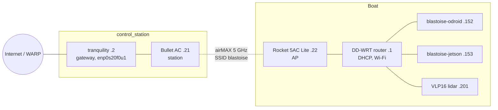

# mhseals_profile

MHSeals' fleet profiles for [astro_dock](https://github.com/1unarzDev/astro_dock): the `roboboat` fleet, the `blastoise` and `squirtle` vessels, and the `control_station` station (the role of any operator laptop). astro_dock's `hw.sh` and `setup.linux.sh` read them for the network, devices, hosts and repositories; astro_dock itself names no team.

| Directory | Holds |
| --- | --- |
| `roboboat/` | the fleet: `profile.yaml`, `topology.yaml` (members and links), `secrets.keys`, `hosts.yaml` (repositories by role), and the shared `router`, `radio`, `lidar`, `jetson` YAMLs |
| `blastoise/` | vessel, extends roboboat: `network.env` (subnet, router, gateway, DHCP range, reservations, DNS, device addresses), `devices.yaml` (host registry), its radios, lidar MAC and Jetson gateway |
| `squirtle/` | vessel stub until its values are known (the legacy Xavier NX, JetPack 5 / Foxy) |
| `control_station/` | station, extends roboboat: the role of every operator laptop (RTK base, heartbeat, testing TUI, gateway); no laptop needs its own profile |

## Use from astro_dock

astro_dock pins this repository as its submodule `profiles/`:

```bash
git submodule update --init profiles      # setup's repos stage and hosts apply do this too
./hw.sh whoami                            # this machine's host and vessel, and how they were found
```

Another checkout works through `ASTRO_PROFILES=/path/to/mhseals_profile`. Fleet machines find themselves (blastoise-odroid and blastoise-jetson by their `STATIC_LEASES` MAC, tranquility by hostname). A registry host with the `operator` role is a control station, so tranquility resolves to host tranquility, vessel blastoise, station `control_station`. Any other operator laptop joins as a control station without a profile or registry entry: `--host NAME` (or `ASTRO_HOST`), or automatically when one of its addresses is on exactly one vessel's `BOAT_SUBNET` (that vessel; `hw.sh whoami` says `boat LAN ADDR in SUBNET`). A boat computer never joins as a station: a Jetson or ODROID (`/proc/device-tree/model`), a leased MAC or a reserved or registry address stays unmatched. Without a vessel, pass `--vessel blastoise` (or export `ASTRO_VESSEL`) for device verbs and `hw.sh env`.

A field edit is two commits: change and push the profile here, then bump the `profiles` pointer in astro_dock, so every host deploys one network plan (`./hw.sh hosts apply` moves them all to one astro_dock commit).

Credentials are never in either repository. Put the keys of [`roboboat/secrets.keys`](roboboat/secrets.keys) in `~/.config/astro/secrets.env` (mode 600; `ASTRO_SECRETS` overrides) and check with `./hw.sh secrets check`, which prints the missing names, never values. The YAMLs name which key each device reads; empty router passwords are prompted.

## Blastoise network

The control station, here the operator laptop tranquility, is the gateway and reaches the boat over a bridged Ubiquiti link, so every device below is on one flat layer-2 LAN, `192.168.0.0/24`:



| Address | Device | Source |
| --- | --- | --- |
| .1 | DD-WRT router: DHCP, DNS, Wi-Fi | static, `hw.sh router` |
| .2 | Gateway laptop | static on its LAN profile |
| .21 / .22 | Bullet AC / Rocket 5AC Lite management | set on each radio |
| .100–.149 | DHCP pool | router |
| .152 / .153 | Boat computer / Jetson | DHCP reservations (`STATIC_LEASES`) |
| .201 | VLP16 lidar (factory .1.201, re-addressed) | static on the sensor |

`./hw.sh env` prints the vessel's network env path, `./hw.sh env KEY` one of its values.

### Hosts and roles

[`blastoise/devices.yaml`](blastoise/devices.yaml) says which computer has which role: `blastoise-odroid` is the boat computer (MAVROS, thrusters), `blastoise-jetson` the camera host (GPU, ZED, lidar) and `tranquility` the operator and gateway (its operator role makes it a `control_station`; another operator laptop needs no entry here). It names no addresses; each host joins `blastoise/network.env` on its name (a `$KEY` or its `STATIC_LEASES` reservation). The ssh names are per host (`blastoise-odroid`, `blastoise-jetson`, `squirtle-jetson`); a vessel name is never an ssh target.

mhseals_testing reads the registry to place each part of the stack on its host and to start or stop it there over ssh and `docker exec`. The ssh key lives in `~/.config/mhseals/ssh/` (`id_ed25519` and `known_hosts`), which the container mounts; on the operator computer `./hw.sh hosts keys` (or `./setup.linux.sh --components operator-key`) creates it if missing, installs it in each other host's `authorized_keys` through your own ssh and records the host keys, and is safe to rerun. A machine that hw.sh cannot recognise passes `--host H` (or `ASTRO_HOST`); the testing TUI also honours `self: <host>` in `~/.config/mhseals/devices.yaml`.

Repositories per role come from [`roboboat/hosts.yaml`](roboboat/hosts.yaml): every host checks out `all` (mhseals_hardware, mhseals_nav, mhseals_testing), the camera host adds direct_lidar_inertial_odometry, the operator rviz-plugin-zed-od and zed-ros2-wrapper. `./hw.sh hosts repos [--role ROLE...]` previews this computer's list.

### Boat computers

Reserve the computer's wired MAC in `STATIC_LEASES` first. `./setup.linux.sh --components boat` on each boat computer drops any hand-set wired address so DHCP supplies it, the gateway and DNS, turns Wi-Fi off, and raises `net.core.rmem_max` to the 4 MiB that astro_dock's `config/fastdds.xml` requests.

A freshly flashed JetPack 6 Jetson (the Orin Nano Super with the ZED 2i on USB) reaches its working state from astro_dock:

```bash
git clone --recurse-submodules https://github.com/1unarzDev/astro_dock.git ~/astro_dock && cd ~/astro_dock
ASTRO_NTP_SERVER=lan ./setup.linux.sh --non-interactive --yes \
  --components clock,docker,gpu,devices,devtools,compose,boat,jetson
sudo reboot
```

After the reboot, start the dev container (astro_dock's *Image publishing and deployment*), then run `./setup.linux.sh --components repos`: it clones this host's repositories and builds them inside the dev container. The ZED SDK downloads the camera's factory calibration by serial number on first use (through the gateway) and keeps it in the `zed_settings` volume. Promote a Jetson image with `./hw.sh jetson apply USER@blastoise-jetson`; [`roboboat/jetson.yaml`](roboboat/jetson.yaml) sets the family and the ssh gateway (tranquility; `HW_GATEWAY=` for direct).

### Time

Boat devices reach `time.cloudflare.com` through the gateway. Run `ASTRO_NTP_ALLOW=lan ./setup.linux.sh --components clock` on blastoise-odroid (chrony) to serve boat time, also without internet, and `ASTRO_NTP_SERVER=lan ./setup.linux.sh --components clock` on the other boat computers: they prefer it, fall back to public servers away from the boat, and step the clock on the first syncs after boot (the Orin has no battery-backed clock). Without internet on the boat, the ODROID follows `BOAT_OPERATOR_TIME_SERVERS`: run `ASTRO_NTP_ALLOW=operator ./setup.linux.sh --components clock` on an operator laptop that has internet time to serve the boat subnet while it is synchronized. astro_dock's `.devcontainer/astro-clock.py` prints every boat host's offset.

### Gateway

On tranquility (any Linux host whose LAN interface has `GATEWAY_IP`), `./setup.linux.sh --components gateway` installs `astro-gateway.service`: IPv4 forwarding and NAT of `BOAT_SUBNET` through the host's normal routing (WARP when connected). Keep the LAN and uplink on different subnets; with NetworkManager a dispatcher marks LAN profiles `never-default`, otherwise configure the boat interface without a default route.

### Radio link

A point-to-point airMAX AC bridge on airOS 8.7.1. Both radios run network mode `bridge` with WDS (transparent bridging) on, so boat hosts see the laptop's own MAC.

| Setting | Rocket 5AC Lite (.22) | Bullet AC `B-DB-AC` (.21) |
| --- | --- | --- |
| Role | access point (PtP) | station |
| SSID / security | `blastoise`, WPA2-AES | `blastoise`, WPA2-AES |
| Frequency / width | 5165 MHz, 40 MHz | follows the AP |
| Management address | static on `br0`, link-local alias on | static on `br0`, link-local alias on |

`./hw.sh radio` uses `radio.yaml` (SSID, roles, MACs, default `cfg` keys) and `UBNT_*_IP`:

| Verb | What it does |
| --- | --- |
| `verify [--via tranquility]` | read-only: ping and ARP each radio, ping the profile's reachable hosts, one UBNT discovery probe |
| `status NAME` | read-only: `mca-status`, `wstalist`, `status.cgi`, radio/wireless keys (secrets dropped), uptime |
| `snapshot NAME` | `/tmp/system.cfg` to `~/.local/state/astro_dock/ubiquiti/` (mode 600; also an airOS backup to upload) |
| `plan NAME [KEY=VALUE ...]` | snapshot and diff only (= `apply --dry-run`) |
| `apply NAME [KEY=VALUE ...]` | RAM-only trial after `APPLY`; reboots into the saved config after 300 s unless `KEEP` |
| `rollback NAME` | ends a pending trial now (reboot into the saved config) |
| `measure` | read-only: both radios' status, iperf3 TCP/UDP both ways to the boat computer with ping alongside; saved under `~/.local/state/astro_dock/link/` |
| `propose [FILE]` | offline: setting changes per radio from the latest measurement, as `plan`/`apply` commands |

`NAME` is `rocket` or `bullet`.

- `apply` takes one radio at a time and refuses while the peer is unreachable or mid-trial. It refuses management-address and link-shared keys (change those in the airOS UI, far radio first). The AP's frequency, center, width and `ieee_mode` are allowed (the station follows), but not outside the station's scan list, and `KEEP` on such a trial needs the peer to answer.
- `propose`: 40 MHz only at noise ≤ −88 dBm and SNR ≥ 25 dB, 20 MHz when noisy; a channel only from `propose.freq` (DFS flagged); polling on, PtP on the AP; ACK fixed for `propose.range_m`; power aimed at −65 to −50 dBm at the peer and raised only with `propose.txpower_max`; shaping off; existing keys only.
- Never a site survey: on airOS it leaves the channel and drops the link. iperf3 runs on each host or in its `measure.container` and is never installed. Run from a boat-LAN host or set `UBNT_JUMP`.
- **Recovery.** If a radio is unreachable at its LAN address, connect a host to the radio's PoE LAN port and browse to the link-local address that `verify` printed (give the host a `169.254.0.0/16` address). As a last resort, hold the reset button for about 10 s to restore factory defaults (`192.168.1.20`). Then upload the latest snapshot, or set the values in the table plus the WPA key, and run `verify`.

### Router

`./hw.sh router` configures the DD-WRT router over ssh from `router.yaml` (name/SSID/admin user, time zone) and the addresses: DHCP with reservations above the pool, DNS and WPA2 Wi-Fi, router WAN/NAT off. `plan` inspects only. `apply` confirms, backs up NVRAM when supported, commits one transaction that restores the previous values 300 s after boot unless the post-reboot `verify` passes, and reboots. `rollback` restores a backup; `key` prints the router key. State: astro_dock's ignored `router_setup_state/` if present, else `~/.local/state/astro_dock/router/`.

### Lidar

A Velodyne VLP16 (`VLP-16-A`, firmware 3.0.41.1) with a static address and no login. It sends 2368/8308 UDP by unicast to the host running the driver, blastoise-jetson (.153): about 8 Mbit/s with single returns, twice with `Dual`, and unicast keeps it off the radio link. Addresses are `LIDAR_*` in `blastoise/network.env` (mhseals_nav reads `LIDAR_IP`); ports, RPM, returns, FOV and MAC are in `lidar.yaml`. `./hw.sh lidar` uses its HTTP API:

- `status`, `plan` and `verify` are read-only; `verify` exits 3 when a profile value differs. `snapshot` saves settings, status and info to `~/.local/state/astro_dock/lidar/`.
- `apply` validates, snapshots and after `APPLY` posts only the differing keys, then saves once. Netmask and gateway go last with a reset, which needs DHCP off, and must be active afterwards. It never moves the address. `rollback [SNAPSHOT]` re-applies a snapshot the same way.
- Run from a boat-LAN host or set `LIDAR_JUMP=tranquility`. **Recovery:** no reset switch. Find it by `ip neigh` (its MAC) or its UDP source, put a host on that subnet, fix it in the web UI, Save Configuration, Reset System. Factory default `192.168.1.201/24`.

VLP16 clouds (~642 KB) use a separate large-data DDS transport; TF, odometry and RViz use the default one. `mhseals_nav/config/fastdds_large_data.xml` (TCP, netmask filtering) is applied by `sensors.launch.py` to the Velodyne driver and transform only. `lidar_relay`, started by the hardware sensor launch, republishes a reduced 32 KiB `/points` on the normal transport for Nav2 and remote RViz; viewers just run `rviz2` in a container shell. To inspect full clouds on the sensor host, set `FASTRTPS_DEFAULT_PROFILES_FILE` and `FASTDDS_DEFAULT_PROFILES_FILE` to `$ROS_WS/install/share/mhseals_nav/config/fastdds_large_data.xml` in a dedicated shell.

With hardware sensors and odometry running, start mapping and navigation on blastoise-odroid:

```bash
ros2 launch mhseals_nav slam.launch.py sim:=false
ros2 launch mhseals_nav navigation.launch.py sim:=false use_lidar:=true
```

Check `ros2 topic hz /points` and `ros2 topic echo /map --once`; see the [mhseals_nav README](https://github.com/MHSeals/mhseals_nav#architecture) for the rest.

## Fleet procedures

Update every boat computer from one shell on a control station (tranquility):

```bash
./hw.sh hosts plan                                   # read-only: heads against origin/main
./hw.sh hosts apply [--image lunarzdev/astro@sha256:DIGEST] [HOST...]
./hw.sh hosts verify
```

`apply` backs up dirty state under `~/.local/state/astro_dock/hosts/` on each ssh host of `blastoise/devices.yaml`, fast-forwards astro_dock (initialising `profiles/`) and the host's repositories to `origin/main`, prunes stale symlink-install links and builds in the dev container. `--image` first commits the running container as `astro-rollback:STAMP`, then recreates it on the image; the named ZED volumes persist. `./hw.sh hosts rollback astro-rollback:STAMP [HOST...]` recreates on the rollback image and builds. Parts are started from the `boat_test` TUI.

## To fill (owner)

- Physical placement and wiring: which end the router and each radio sit on, and what connects to the laptop's `enp0s20f0u1`.
- Where the team keeps the radio and router passwords and the WPA key, outside `secrets.env`.
- The Rocket's own default gateway is `192.168.1.1`, which is off this subnet; set it to the router in the airOS UI if the radio needs NTP or firmware checks.
- squirtle's network env and registry; it must not reuse `192.168.0.0/24`, the `blastoise-*` names or blastoise's ROS domain.
- The live router still leases .153 to `squirtle-jetson` (`48:b0:2d:51:44:32`); `./hw.sh router plan`, then `apply`.
